```{=html}
<div class="lab-slideshow-container" id="labSlideshow" aria-label="Frank Lab Group Photos Slideshow" role="region">
  <div class="lab-slide-badge" id="slideBadge">1 / 15</div>

  <div class="lab-slideshow-track">
    <!-- Slide 1 -->
    <div class="lab-slide active" data-index="0">
      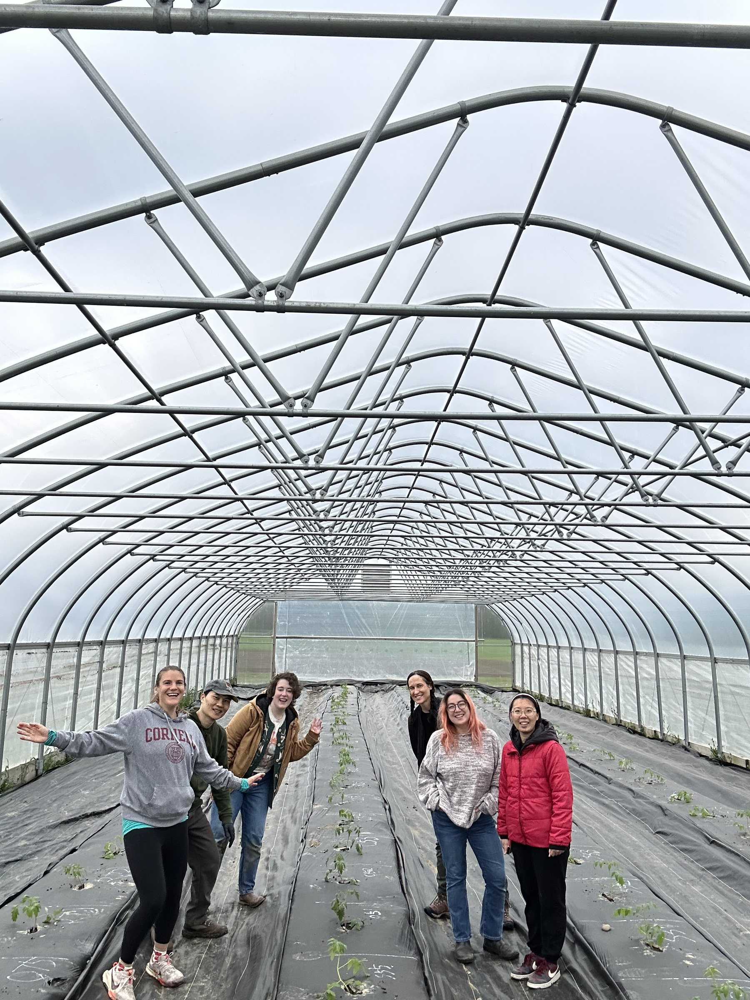
      <div class="lab-slide-overlay">
        <div class="lab-slide-caption">
          <span class="lab-slide-subtitle">Field Season 2026</span>
          <span class="lab-slide-title">Greenhouse Grafting &amp; Phenotyping</span>
        </div>
      </div>
    </div>
    <!-- Slide 2 -->
    <div class="lab-slide" data-index="1">
      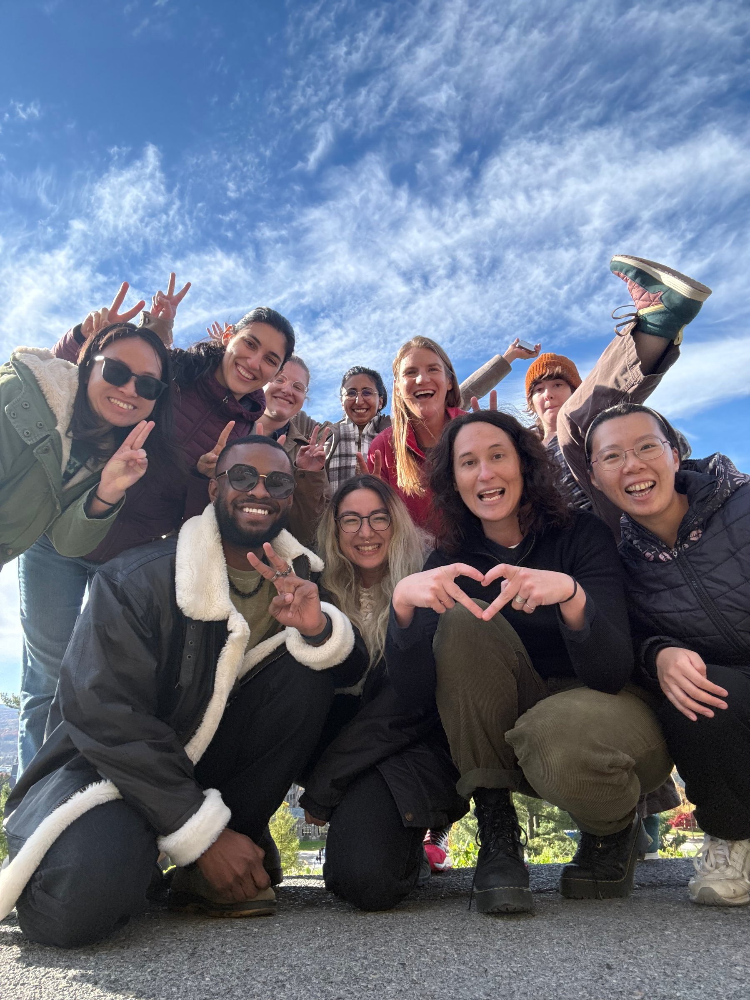
      <div class="lab-slide-overlay">
        <div class="lab-slide-caption">
          <span class="lab-slide-subtitle">Frank Lab Team</span>
          <span class="lab-slide-title">Plant Biology &amp; Molecular Genetics</span>
        </div>
      </div>
    </div>
    <!-- Slide 3 -->
    <div class="lab-slide" data-index="2">
      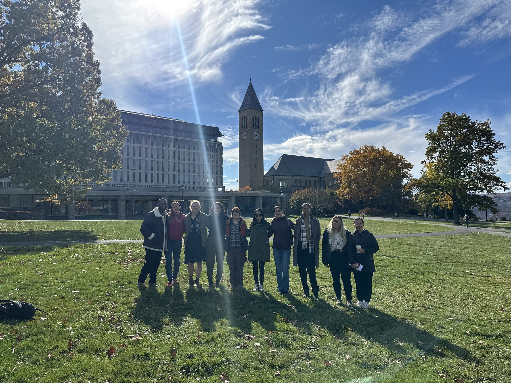
      <div class="lab-slide-overlay">
        <div class="lab-slide-caption">
          <span class="lab-slide-subtitle">Cornell University</span>
          <span class="lab-slide-title">Frank Lab on the Arts Quad &amp; McGraw Tower</span>
        </div>
      </div>
    </div>
    <!-- Slide 4 -->
    <div class="lab-slide" data-index="3">
      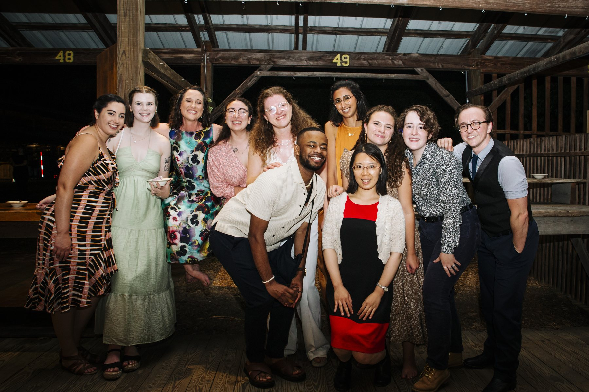
      <div class="lab-slide-overlay">
        <div class="lab-slide-caption">
          <span class="lab-slide-subtitle">Lab Celebrations</span>
          <span class="lab-slide-title">Celebrating Arielle&#x27;s Wedding Together</span>
        </div>
      </div>
    </div>
    <!-- Slide 5 -->
    <div class="lab-slide" data-index="4">
      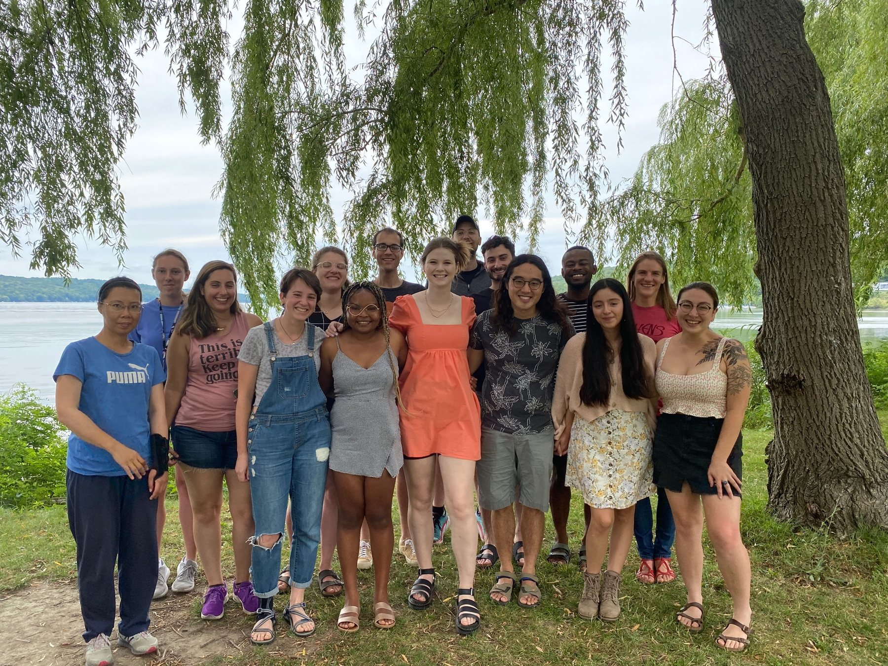
      <div class="lab-slide-overlay">
        <div class="lab-slide-caption">
          <span class="lab-slide-subtitle">Summer Gathering</span>
          <span class="lab-slide-title">Team Outing along Cayuga Lake</span>
        </div>
      </div>
    </div>
    <!-- Slide 6 -->
    <div class="lab-slide" data-index="5">
      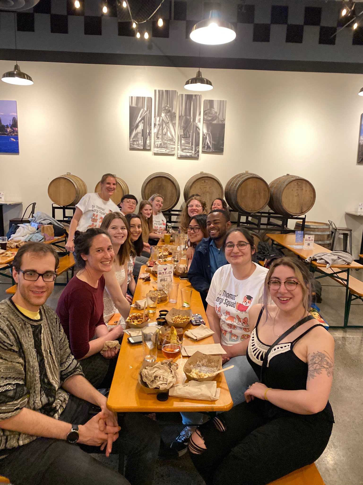
      <div class="lab-slide-overlay">
        <div class="lab-slide-caption">
          <span class="lab-slide-subtitle">Lab Community</span>
          <span class="lab-slide-title">Lab Dinner &amp; Social Gathering</span>
        </div>
      </div>
    </div>
    <!-- Slide 7 -->
    <div class="lab-slide" data-index="6">
      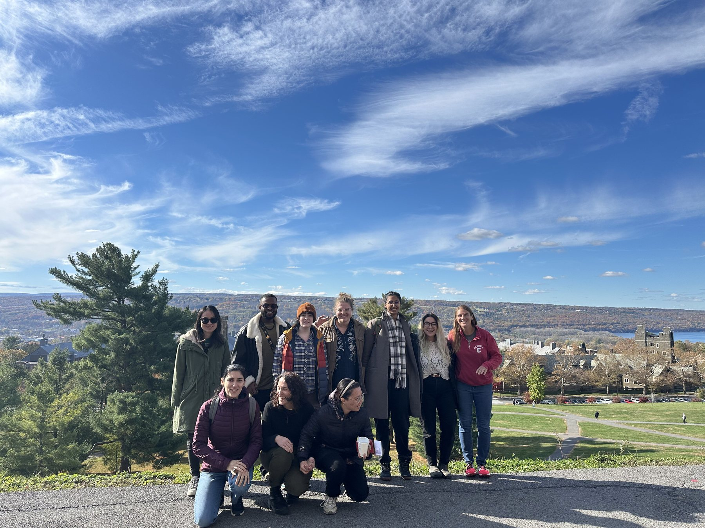
      <div class="lab-slide-overlay">
        <div class="lab-slide-caption">
          <span class="lab-slide-subtitle">Ithaca, NY</span>
          <span class="lab-slide-title">Cayuga Lake Overlook with the Frank Lab Team</span>
        </div>
      </div>
    </div>
    <!-- Slide 8 -->
    <div class="lab-slide" data-index="7">
      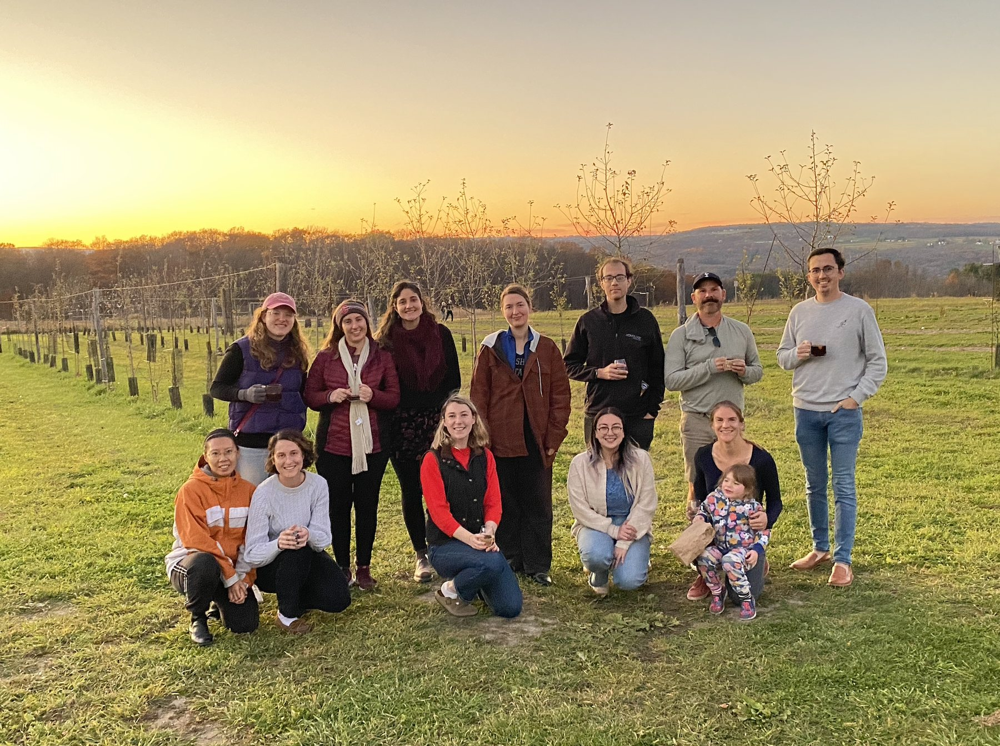
      <div class="lab-slide-overlay">
        <div class="lab-slide-caption">
          <span class="lab-slide-subtitle">Finger Lakes</span>
          <span class="lab-slide-title">Sunset Gathering at the Vineyard</span>
        </div>
      </div>
    </div>
    <!-- Slide 9 -->
    <div class="lab-slide" data-index="8">
      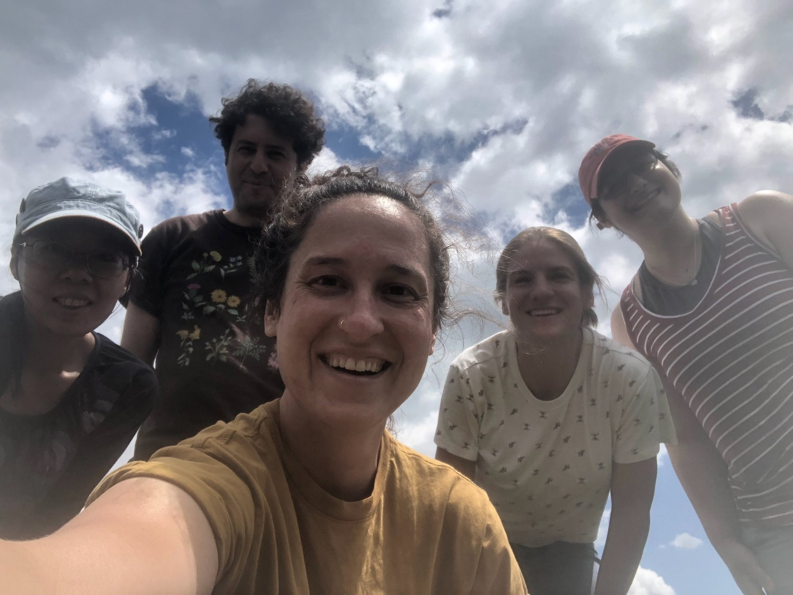
      <div class="lab-slide-overlay">
        <div class="lab-slide-caption">
          <span class="lab-slide-subtitle">Lab Moments</span>
          <span class="lab-slide-title">Research Team Smiles in the Field</span>
        </div>
      </div>
    </div>
    <!-- Slide 10 -->
    <div class="lab-slide" data-index="9">
      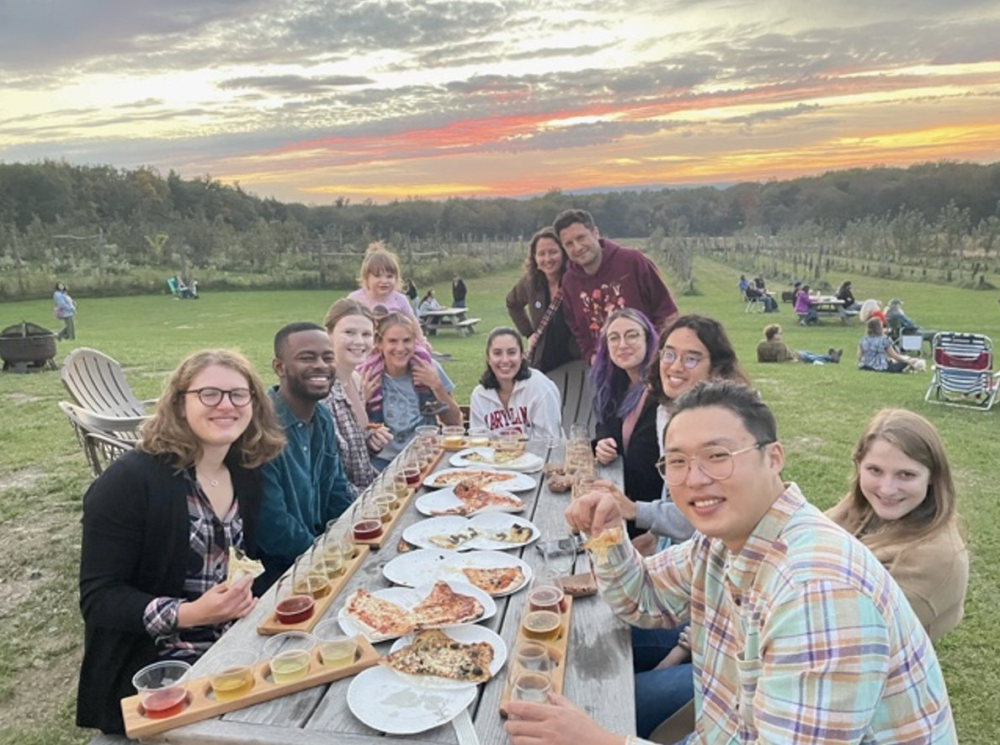
      <div class="lab-slide-overlay">
        <div class="lab-slide-caption">
          <span class="lab-slide-subtitle">Lab Outings</span>
          <span class="lab-slide-title">Sunset Dinner &amp; Cider Tasting</span>
        </div>
      </div>
    </div>
    <!-- Slide 11 -->
    <div class="lab-slide" data-index="10">
      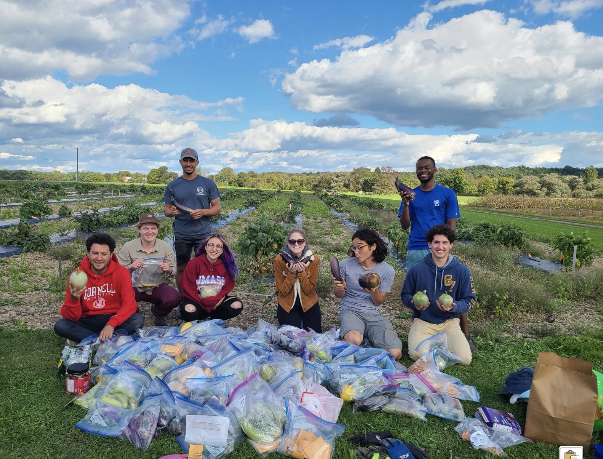
      <div class="lab-slide-overlay">
        <div class="lab-slide-caption">
          <span class="lab-slide-subtitle">Field Season</span>
          <span class="lab-slide-title">Harvesting Experimental Lines in the Field</span>
        </div>
      </div>
    </div>
    <!-- Slide 12 -->
    <div class="lab-slide" data-index="11">
      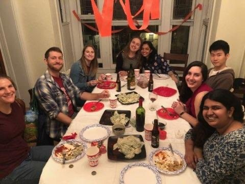
      <div class="lab-slide-overlay">
        <div class="lab-slide-caption">
          <span class="lab-slide-subtitle">Traditions</span>
          <span class="lab-slide-title">Annual Frank Lab Holiday Celebration</span>
        </div>
      </div>
    </div>
    <!-- Slide 13 -->
    <div class="lab-slide" data-index="12">
      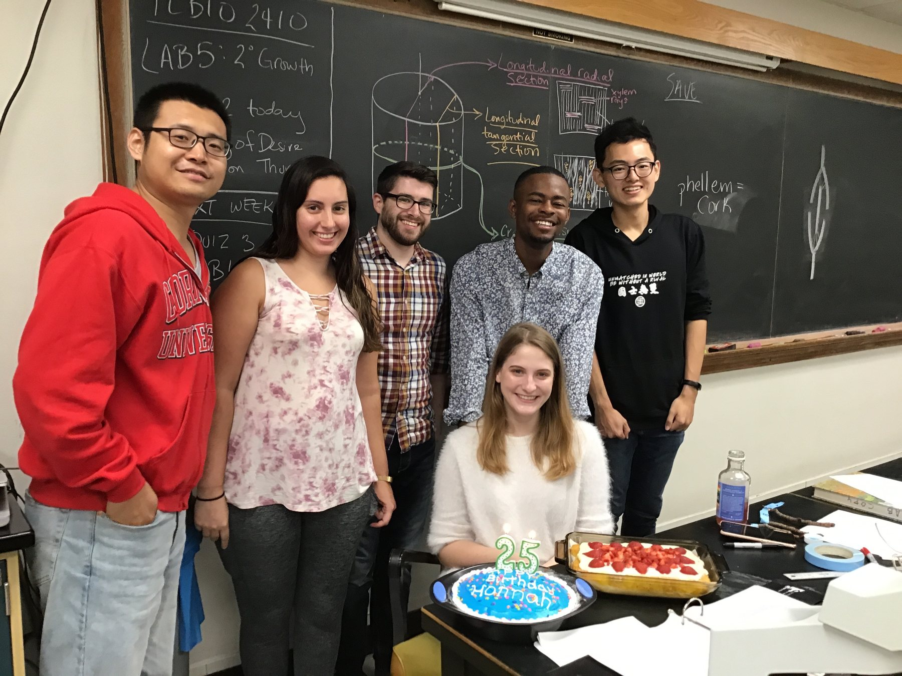
      <div class="lab-slide-overlay">
        <div class="lab-slide-caption">
          <span class="lab-slide-subtitle">Lab Milestones</span>
          <span class="lab-slide-title">Birthday Celebrations in the Lab</span>
        </div>
      </div>
    </div>
    <!-- Slide 14 -->
    <div class="lab-slide" data-index="13">
      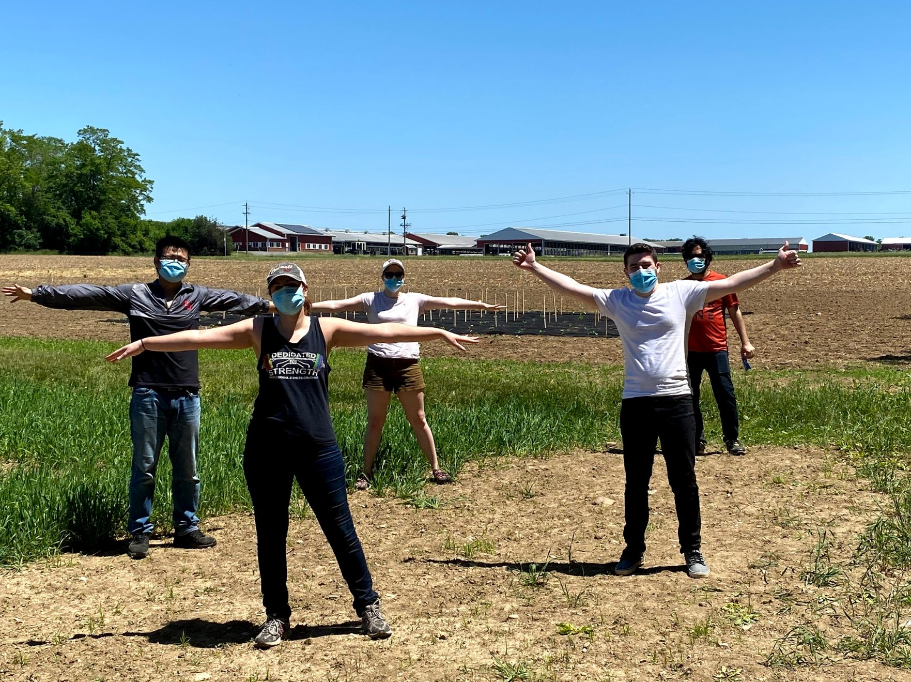
      <div class="lab-slide-overlay">
        <div class="lab-slide-caption">
          <span class="lab-slide-subtitle">Field Research</span>
          <span class="lab-slide-title">Field Trials &amp; Grafting Experiments</span>
        </div>
      </div>
    </div>
    <!-- Slide 15 -->
    <div class="lab-slide" data-index="14">
      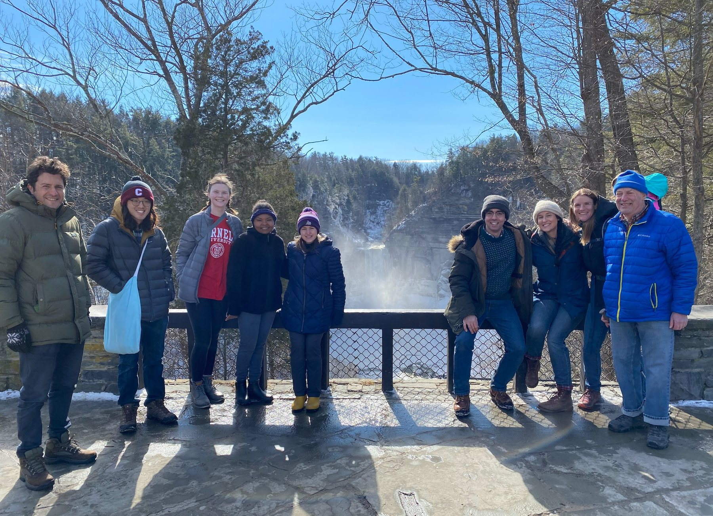
      <div class="lab-slide-overlay">
        <div class="lab-slide-caption">
          <span class="lab-slide-subtitle">Lab Outings</span>
          <span class="lab-slide-title">Taughannock Falls State Park • Ithaca, NY</span>
        </div>
      </div>
    </div>
  </div>

  <!-- Navigation Arrows -->
  <button class="lab-slide-nav lab-slide-prev" id="prevSlide" aria-label="Previous slide">&#8249;</button>
  <button class="lab-slide-nav lab-slide-next" id="nextSlide" aria-label="Next slide">&#8250;</button>

  <!-- Pagination Dots -->
  <div class="lab-slide-dots" id="slideDots">
    <button class="lab-dot active" data-index="0" aria-label="Go to slide 1"></button>
    <button class="lab-dot" data-index="1" aria-label="Go to slide 2"></button>
    <button class="lab-dot" data-index="2" aria-label="Go to slide 3"></button>
    <button class="lab-dot" data-index="3" aria-label="Go to slide 4"></button>
    <button class="lab-dot" data-index="4" aria-label="Go to slide 5"></button>
    <button class="lab-dot" data-index="5" aria-label="Go to slide 6"></button>
    <button class="lab-dot" data-index="6" aria-label="Go to slide 7"></button>
    <button class="lab-dot" data-index="7" aria-label="Go to slide 8"></button>
    <button class="lab-dot" data-index="8" aria-label="Go to slide 9"></button>
    <button class="lab-dot" data-index="9" aria-label="Go to slide 10"></button>
    <button class="lab-dot" data-index="10" aria-label="Go to slide 11"></button>
    <button class="lab-dot" data-index="11" aria-label="Go to slide 12"></button>
    <button class="lab-dot" data-index="12" aria-label="Go to slide 13"></button>
    <button class="lab-dot" data-index="13" aria-label="Go to slide 14"></button>
    <button class="lab-dot" data-index="14" aria-label="Go to slide 15"></button>
  </div>
</div>

<script>
(function() {
  function initSlideshow() {
    const container = document.getElementById('labSlideshow');
    if (!container) return;

    const slides = container.querySelectorAll('.lab-slide');
    const dots = container.querySelectorAll('.lab-dot');
    const badge = document.getElementById('slideBadge');
    const prevBtn = document.getElementById('prevSlide');
    const nextBtn = document.getElementById('nextSlide');
    let current = 0;
    const total = slides.length;
    let timer = null;

    function goToSlide(n) {
      slides[current].classList.remove('active');
      dots[current].classList.remove('active');
      current = (n + total) % total;
      slides[current].classList.add('active');
      dots[current].classList.add('active');
      if (badge) badge.textContent = (current + 1) + ' / ' + total;
    }

    function nextSlide() { goToSlide(current + 1); }
    function prevSlide() { goToSlide(current - 1); }

    function startTimer() {
      stopTimer();
      timer = setInterval(nextSlide, 5000);
    }
    function stopTimer() {
      if (timer) clearInterval(timer);
    }

    if (prevBtn) {
      prevBtn.addEventListener('click', function(e) {
        e.preventDefault();
        prevSlide();
        startTimer();
      });
    }

    if (nextBtn) {
      nextBtn.addEventListener('click', function(e) {
        e.preventDefault();
        nextSlide();
        startTimer();
      });
    }

    dots.forEach(function(dot, idx) {
      dot.addEventListener('click', function(e) {
        e.preventDefault();
        goToSlide(idx);
        startTimer();
      });
    });

    container.addEventListener('mouseenter', stopTimer);
    container.addEventListener('mouseleave', startTimer);

    container.setAttribute('tabindex', '0');
    container.addEventListener('keydown', function(e) {
      if (e.key === 'ArrowLeft') {
        prevSlide();
        startTimer();
      } else if (e.key === 'ArrowRight') {
        nextSlide();
        startTimer();
      }
    });

    let touchStartX = 0;
    let touchEndX = 0;
    container.addEventListener('touchstart', function(e) {
      touchStartX = e.changedTouches[0].screenX;
    }, { passive: true });

    container.addEventListener('touchend', function(e) {
      touchEndX = e.changedTouches[0].screenX;
      if (touchStartX - touchEndX > 50) {
        nextSlide();
        startTimer();
      } else if (touchEndX - touchStartX > 50) {
        prevSlide();
        startTimer();
      }
    }, { passive: true });

    startTimer();
  }

  if (document.readyState === 'loading') {
    document.addEventListener('DOMContentLoaded', initSlideshow);
  } else {
    initSlideshow();
  }
})();
</script>
```

## Current Lab Members

<div class="people-grid">

<div class="person-card">
<div class="person-photo-wrapper">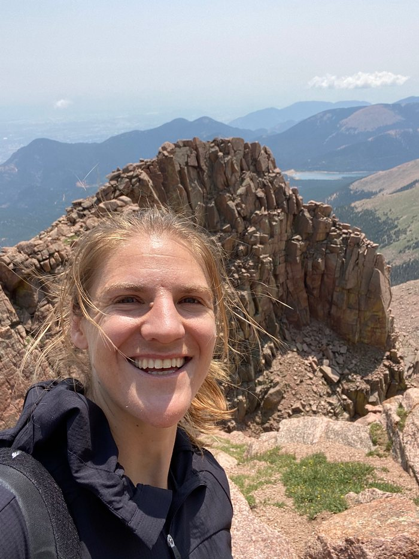</div>
<div class="person-details">
<h3 class="person-name">Dr. Margaret Frank</h3>
<p class="person-role">Principal Investigator</p>
<div class="person-bio"><p>Margaret is a molecular plant biologist who is broadly interested in understanding how multicellular organisms communicate across tissues and organ systems, and applying this knowledge towards sustainable crop production. Margaret joined Cornell's School of Integrative Plant Science (<a href="https://sips.cals.cornell.edu/" target="_blank" rel="noopener">SIPS</a>) in July 2018. Prior to moving to Cornell, Margaret was an NSF PGRP Postdoctoral Fellow at the Donald Danforth Plant Science Center in St Louis, MO, where she studied the dynamics of graft junction formation and graft-transmissible RNA movement.</p><p>Margaret earned her PhD at Cornell, working with <a href="http://scanlonlab.plantbio.cornell.edu/" target="_blank" rel="noopener">Mike Scanlon</a> on the evolution of shoot meristem patterning in early land plant lineages.</p><p>When she's not doing science, Margaret loves to run, travel, and drink coffee.</p></div>
</div>
</div>

<div class="person-card">
<div class="person-photo-wrapper">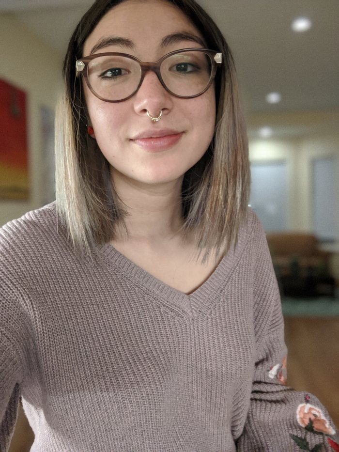</div>
<div class="person-details">
<h3 class="person-name">Michelle Heeney</h3>
<p class="person-role">Ph.D. Candidate</p>
<div class="person-bio"><p>Michelle is a PhD student in the Frank Lab and the <a href="https://roeder.wicmb.cornell.edu/" target="_blank" rel="noopener">Roeder Lab</a>. She works on dissecting the underpinnings controlling and influencing long distance mRNA movement. Michelle graduated from the University of Massachusetts with two B.S.' one in biology and one in math with a concentration in statistics. Her undergraduate thesis work focused on floral morphology in grasses, under the guidance of <a href="http://www.bartlettlab.org/" target="_blank" rel="noopener">Dr. Madelaine Bartlett</a>.</p><p>Michelle also worked in the biotech industry at the startup company <a href="https://inari.com/" target="_blank" rel="noopener">Inari Agriculture</a> where she developed her skills of plant transformation and bioinformatics.</p><p>Outside of the lab Michelle has a passion for film photography and fine art.</p></div>
</div>
</div>

<div class="person-card">
<div class="person-photo-wrapper">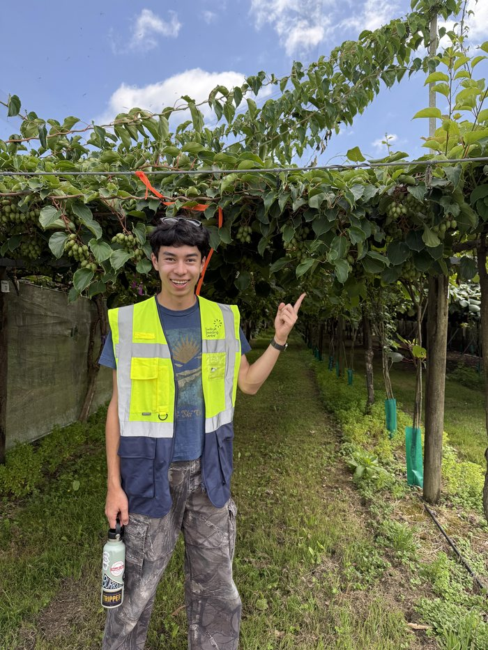</div>
<div class="person-details">
<h3 class="person-name">Zachary Joseph Ruwitch</h3>
<p class="person-role">Undergraduate Researcher</p>
<div class="person-bio"><p>Zachary is an undergraduate researcher in the Frank Lab, working under the mentorship of Sam Yanders. He is majoring in Plant Sciences with a concentration in Integrative Genomics and Molecular Biology, and also conducts research in the Mazourek Lab at Cornell University. His academic interests center on plant genetics, molecular biology, and the role of agriculture in sustainable development.</p><p>Outside of the lab, Zach enjoys camping, canoeing, and rock climbing. He’s also a big St. Louis Cardinals and Blues fan.</p></div>
</div>
</div>

<div class="person-card">
<div class="person-photo-wrapper">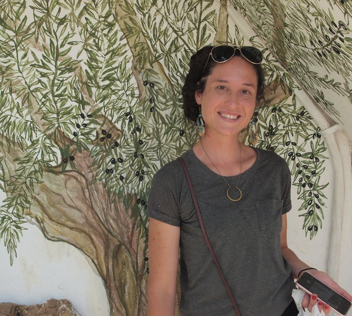</div>
<div class="person-details">
<h3 class="person-name">Elise Boisvert</h3>
<p class="person-role">Ph.D. Candidate</p>
<div class="person-bio"><p>Elise is a PhD student in the Frank lab where she works to shine light on the inner workings of grafted plants. She studies what is happening on a cellular and molecular level as the plant works to heal and join together. Elise started in the Frank lab during her undergraduate at Cornell. Her undergraduate work included a focus in rootstocks and root architecture, and in heterografting solanaceous plants to track mRNA movement.</p><p>Outside of the lab, Elise enjoys kayaking, hiking, and hanging out with her cute dogs.</p></div>
</div>
</div>

<div class="person-card">
<div class="person-photo-wrapper">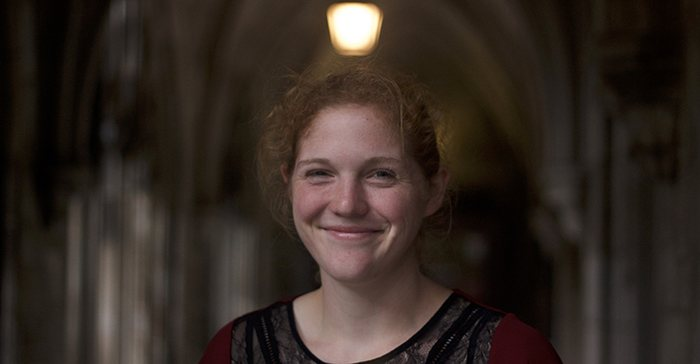</div>
<div class="person-details">
<h3 class="person-name">Jessica Morgan</h3>
<p class="person-role">Post-Doctoral Researcher</p>
<div class="person-bio"><p>More to come!</p></div>
</div>
</div>

<div class="person-card">
<div class="person-photo-wrapper">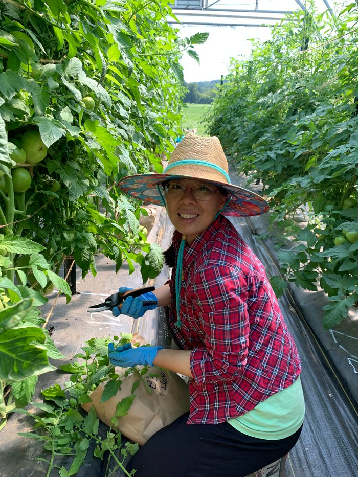</div>
<div class="person-details">
<h3 class="person-name">Tian Gong</h3>
<p class="person-role">Post-Doctoral Researcher</p>
<div class="person-bio"><p>Tian is a post-doctoral researcher in the Frank lab. She’s working on grafted tomato production under high tunnel conditions.</p><p>Tian got her Ph.D. in Horticultural Sciences from the University of Florida.</p><p>Tian is known to enjoy exploring Ithaca and eating Cornell dairy ice cream in her free time!</p></div>
</div>
</div>

<div class="person-card">
<div class="person-photo-wrapper">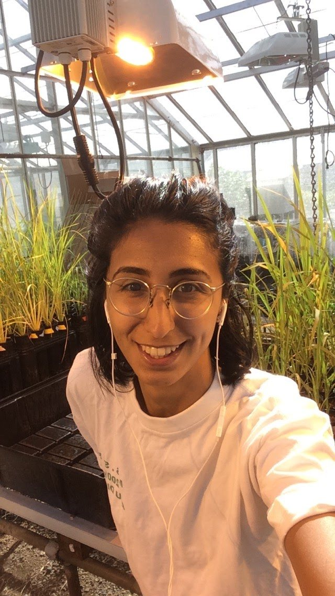</div>
<div class="person-details">
<h3 class="person-name">Noor AlBader</h3>
<p class="person-role">Post-Doctoral Researcher</p>
<div class="person-bio"><p>Noor broadly studies the transcriptional response to abiotic and biotic stressors in plants. Her work has encompassed staple crops such as rice, to novelty organisms such as chia and the beaver. Her genomic work has also led her to work on date palm and wild relatives of rice, with a focus on adaptation to desert and costal regions, respectively, at the Center of Desert Agriculture (KAUST).

She completed her PhD (2019) in the Molecular and Cellular Biology Program at Oregon State University (OSU). She is now a post-doctoral researcher, co-hosted by the Frank and <a href="https://btiscience.org/andrew-nelson/" target="_blank" rel="noopener">Nelson</a> labs.</p></div>
</div>
</div>

<div class="person-card">
<div class="person-photo-wrapper">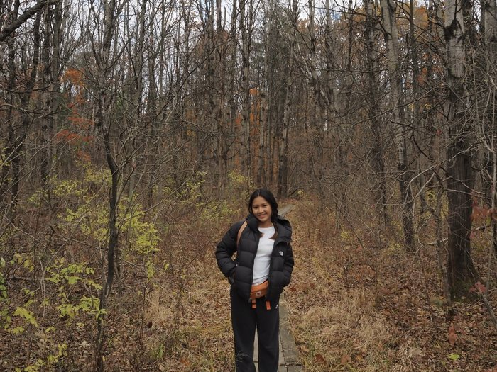</div>
<div class="person-details">
<h3 class="person-name">Tin Aye</h3>
<p class="person-role">Undergraduate Researcher</p>
<div class="person-bio"><p>coming soon!</p></div>
</div>
</div>

<div class="person-card">
<div class="person-photo-wrapper">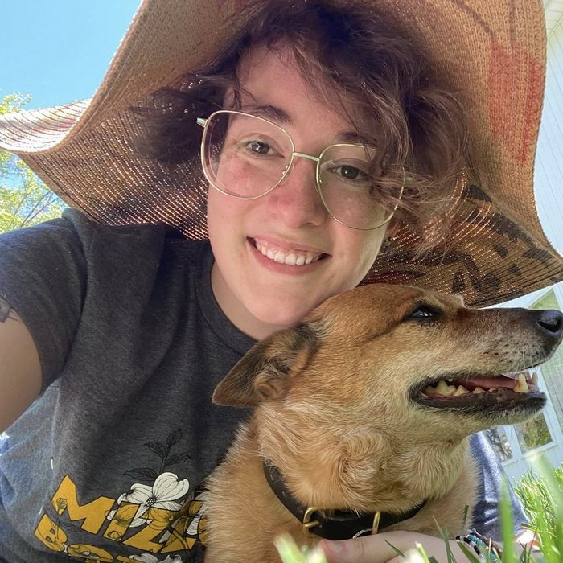</div>
<div class="person-details">
<h3 class="person-name">Sam Yanders</h3>
<p class="person-role">Ph.D. Student</p>
<div class="person-bio"><p>Sam is a PhD student in the Frank lab where she studies the mechanisms that regulate graft compatibility. She received her B.S. in Plant Sciences with emphases in Biology, Horticulture, and Crop Sciences from the University of Missouri. Her undergraduate research focused on the characterization of genes related to ATP stress signaling in the lab of Dr. Gary Stacey, as well as teaching undergraduate courses under the guidance of Dr. Mary Ann Gowdy.

In her free time, Sam enjoys kayaking, cooking, playing video games, spending time with friends, and making her dog wear funny clothes.</p></div>
</div>
</div>

<div class="person-card">
<div class="person-photo-wrapper">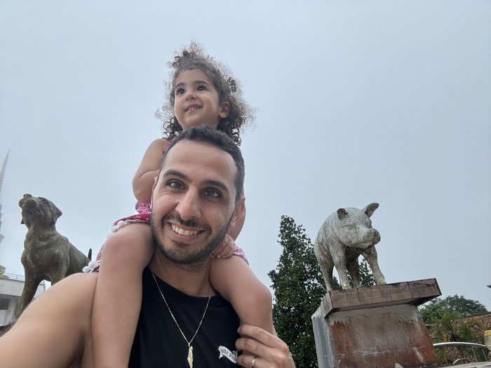</div>
<div class="person-details">
<h3 class="person-name">Israel Gabay</h3>
<p class="person-role">Post-Doctoral Researcher</p>
<div class="person-bio"><p>Israel is a postdoc investigating the coupling of hydromechanical and electrophysiological processes in mediating long-distance signals in crops. His research aims to enhance our understanding of the inner communication system in plants and leverage this knowledge to guide crop improvement and plant bioengineering.

Israel holds a Ph.D. in mechanical engineering from the Technion - Israel Institute of Technology. He is hosted by the Frank and Stroock labs and supported by the Fulbright Fellowship.

In his free time, Israel enjoys spending time with friends and family and playing soccer.</p></div>
</div>
</div>

<div class="person-card">
<div class="person-photo-wrapper">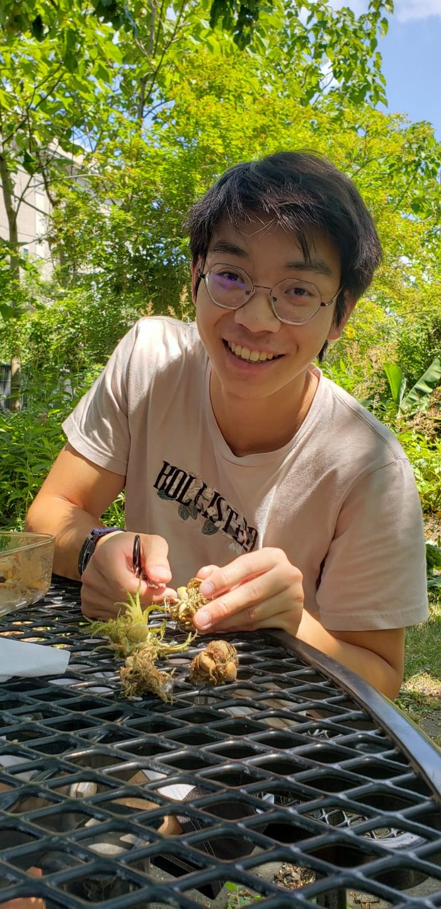</div>
<div class="person-details">
<h3 class="person-name">Antone Jung</h3>
<p class="person-role">Undergraduate Researcher</p>
<div class="person-bio"><p>Antone is mentored by graduate student Michelle Heeney and works jointly between the Frank lab and the lab of Dr. Adrienne Roeder.</p></div>
</div>
</div>

<div class="person-card">
<div class="person-photo-wrapper">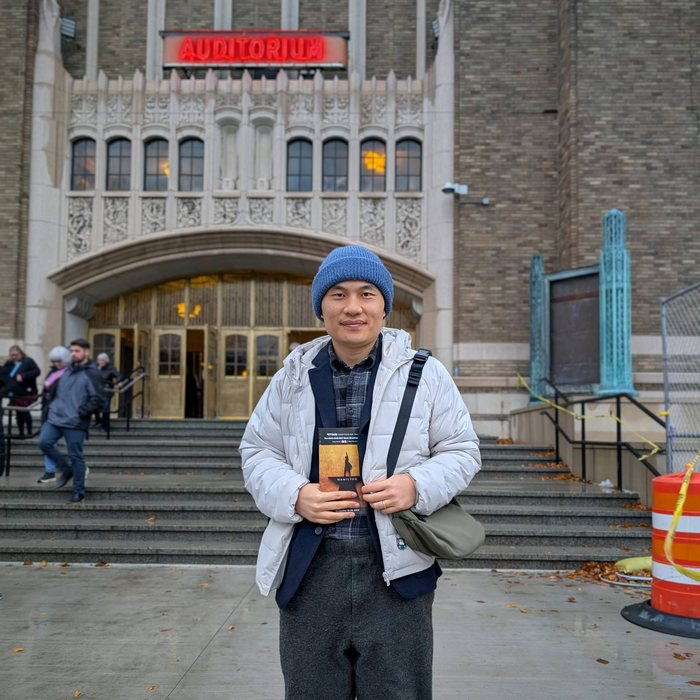</div>
<div class="person-details">
<h3 class="person-name">Xing Ma</h3>
<p class="person-role">Laboratory Technician</p>
<div class="person-bio"><p>Xing is a plant pathologist who pinpointed Dickeya dianthicola as the source of potato blackleg and soft rot outbreaks after 2014 in the Northeast US. His work also identified the potential of wild species Solanum microdontum to build better disease resistance into potato crops.

With a PhD from THE OSU and a decade of research experience at Cornell, Xing has deep expertise in pathogen genomics and bioinformatics. When he’s off the clock, you’ll likely find him researching computer parts for his next PC build, playing video games, or catching up on music.</p></div>
</div>
</div>

<div class="person-card">
<div class="person-photo-wrapper">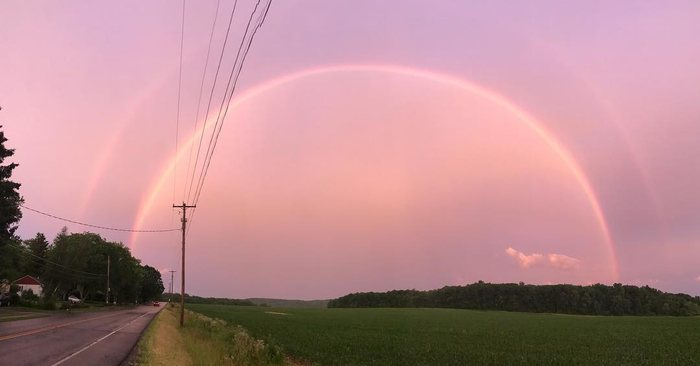</div>
<div class="person-details">
<h3 class="person-name">Henry Sun</h3>
<p class="person-role">Undergraduate Researcher</p>
<div class="person-bio"><p>more coming soon!</p></div>
</div>
</div>

<div class="person-card">
<div class="person-photo-wrapper">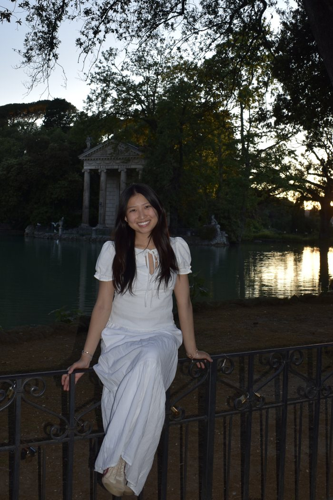</div>
<div class="person-details">
<h3 class="person-name">Emma Nam</h3>
<p class="person-role">Undergraduate Researcher</p>
<div class="person-bio"><p>Emma is an undergraduate researcher in the Frank Lab working under the mentorship of Israel Gabay. As a Chemical Engineering student, she is passionate about understanding how plants communicate and respond to their environment, with broader interests in sustainable agriculture and engineering approaches to biology. Outside the lab, Emma is a member of the Cornell Cheerleading Team and enjoys expressing her creativity through sewing, baking, and growing her collection of Smiskis. In her free time, she loves staying active through running and spending time outdoors.</p></div>
</div>
</div>

<div class="person-card">
<div class="person-photo-wrapper">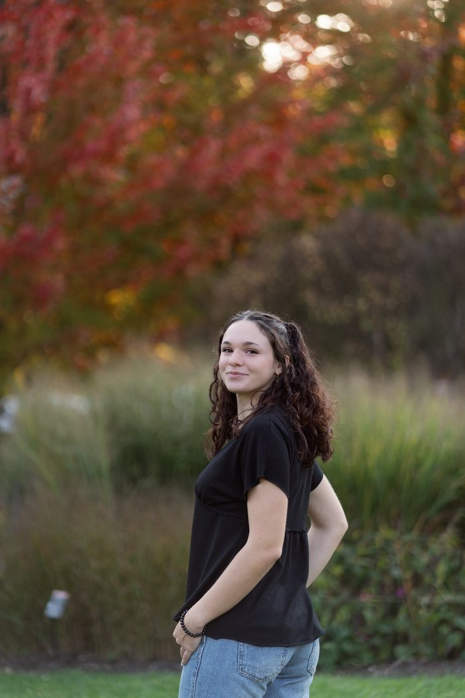</div>
<div class="person-details">
<h3 class="person-name">Lucia Gore</h3>
<p class="person-role">Undergraduate Researcher</p>
<div class="person-bio"><p>Lucia just finished her freshman year at Cornell as a plant science major, hoping to minor in nutrition. Her academic interests include plant genetics, nutrition, food science, and community outreach/engagement.

Outside of the lab, she enjoys running, boxing, painting, and drawing, and engaging with the community.</p></div>
</div>
</div>

<div class="person-card">
<div class="person-photo-wrapper">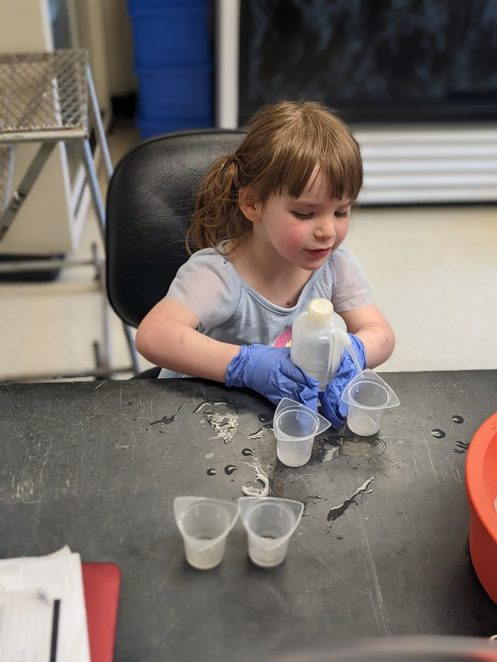</div>
<div class="person-details">
<h3 class="person-name">Guinevere Goldberg</h3>
<p class="person-role">Scientist in training</p>
<div class="person-bio"><p>Gwenny joined the lab in November 2019. Since then she has provided her expertise in tomato taste-testing. She can be found joining Margaret in meetings, stomping in puddles, or enjoying school.</p></div>
</div>
</div>

<div class="person-card">
<div class="person-photo-wrapper">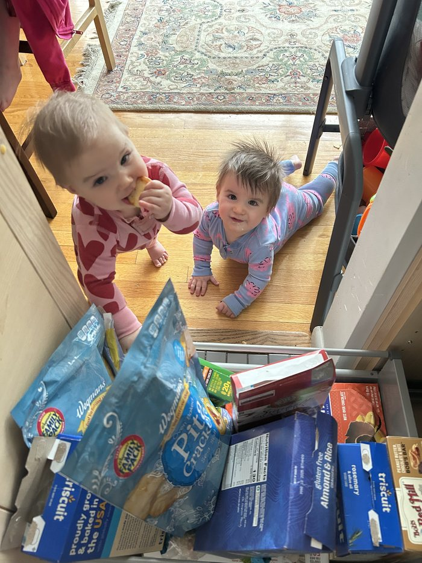</div>
<div class="person-details">
<h3 class="person-name">Annabel and Graham</h3>
<p class="person-role">Scientists in training</p>
<div class="person-bio"><p>Annabel and Graham joined the lab in June 2024. They are preparing for fruitful careers in field research</p><p>Past Members</p></div>
</div>
</div>

<div class="person-card">
<div class="person-photo-wrapper"></div>
<div class="person-details">
<h3 class="person-name">Weiwei Chen</h3>
<p class="person-role">Post-Doctoral Researcher</p>

</div>
</div>

</div>

## Alumni

<div class="people-grid">

<div class="person-card">
<div class="person-photo-wrapper">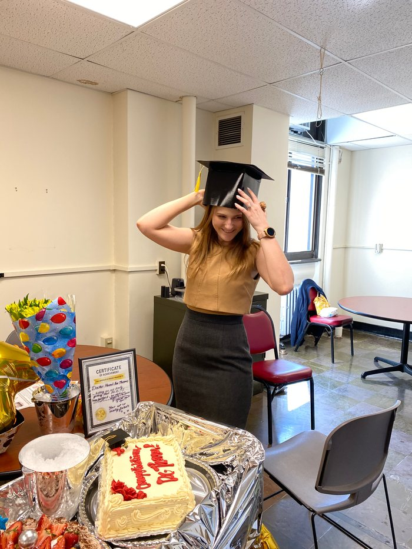</div>
<div class="person-details">
<h3 class="person-name">Dr. Hannah Rae Thomas</h3>
<p class="person-role">Ph.D. Recipient</p>

</div>
</div>

<div class="person-card">
<div class="person-photo-wrapper">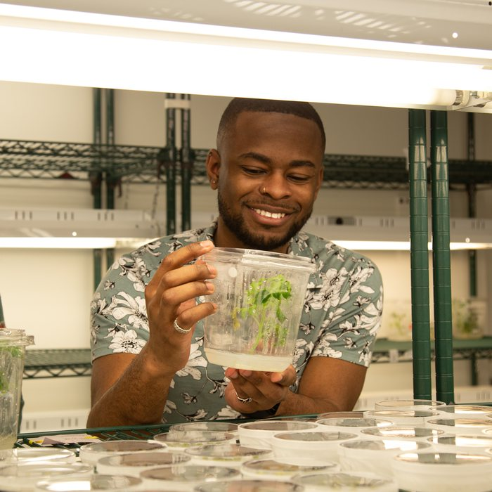</div>
<div class="person-details">
<h3 class="person-name">Dr. Brandon Williams</h3>
<p class="person-role">Ph.D. Recipient</p>

</div>
</div>

<div class="person-card">
<div class="person-photo-wrapper">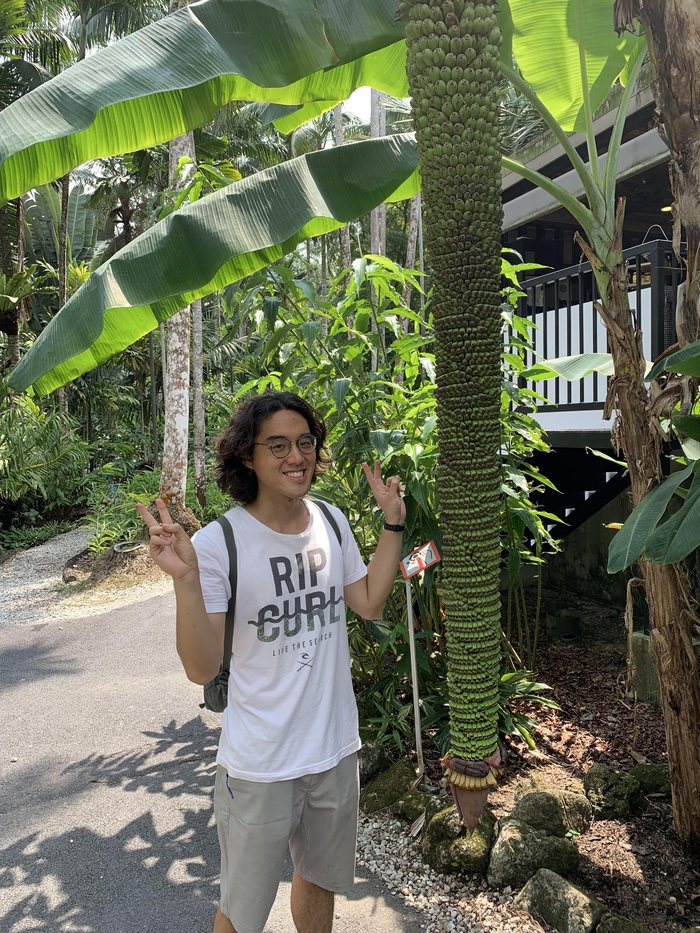</div>
<div class="person-details">
<h3 class="person-name">Paul Ren-Huang Chong</h3>
<p class="person-role">Undergraduate Researcher</p>

</div>
</div>

<div class="person-card">
<div class="person-photo-wrapper">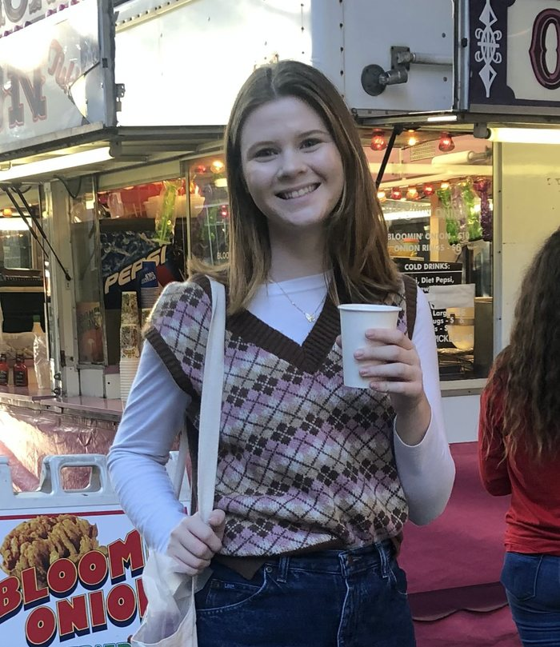</div>
<div class="person-details">
<h3 class="person-name">Audrey Widmier</h3>
<p class="person-role">NSF REPS Intern</p>

</div>
</div>

<div class="person-card">
<div class="person-photo-wrapper"></div>
<div class="person-details">
<h3 class="person-name">Jenny Probst</h3>
<p class="person-role">Undergraduate Lab Tech</p>

</div>
</div>

<div class="person-card">
<div class="person-photo-wrapper">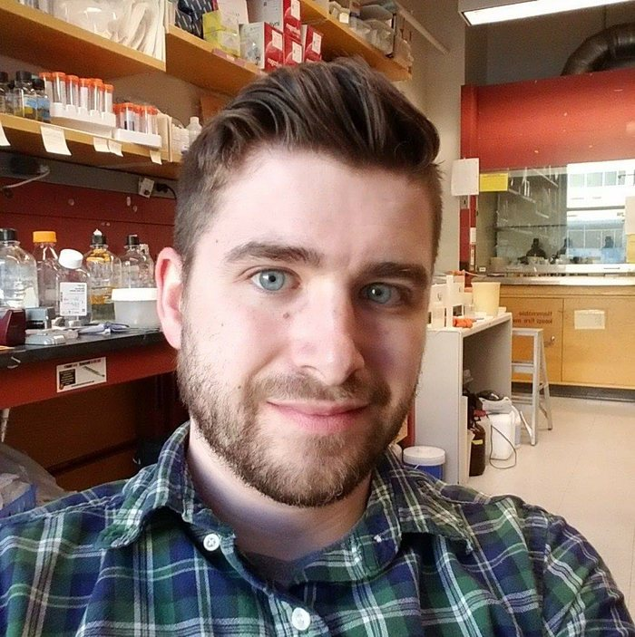</div>
<div class="person-details">
<h3 class="person-name">Dr. Kevin Hines</h3>
<p class="person-role">Lab Tech</p>

</div>
</div>

<div class="person-card">
<div class="person-photo-wrapper">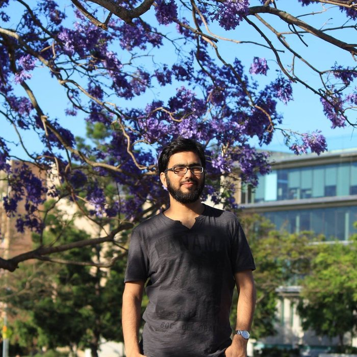</div>
<div class="person-details">
<h3 class="person-name">Umair Ahsan</h3>
<p class="person-role">Post-Doctoral Researcher</p>

</div>
</div>

<div class="person-card">
<div class="person-photo-wrapper">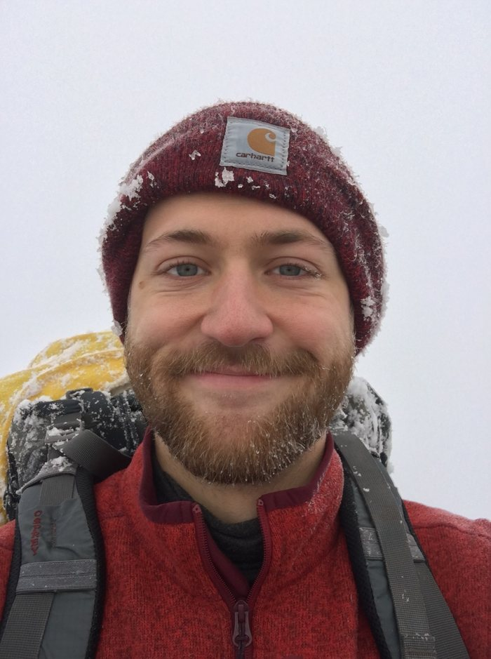</div>
<div class="person-details">
<h3 class="person-name">Matthew Hecking</h3>
<p class="person-role">Lab Tech</p>

</div>
</div>

<div class="person-card">
<div class="person-photo-wrapper">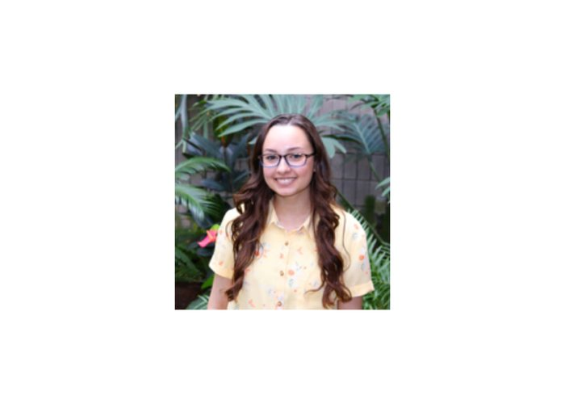</div>
<div class="person-details">
<h3 class="person-name">Sophia Monroe</h3>
<p class="person-role">REU Intern</p>

</div>
</div>

<div class="person-card">
<div class="person-photo-wrapper">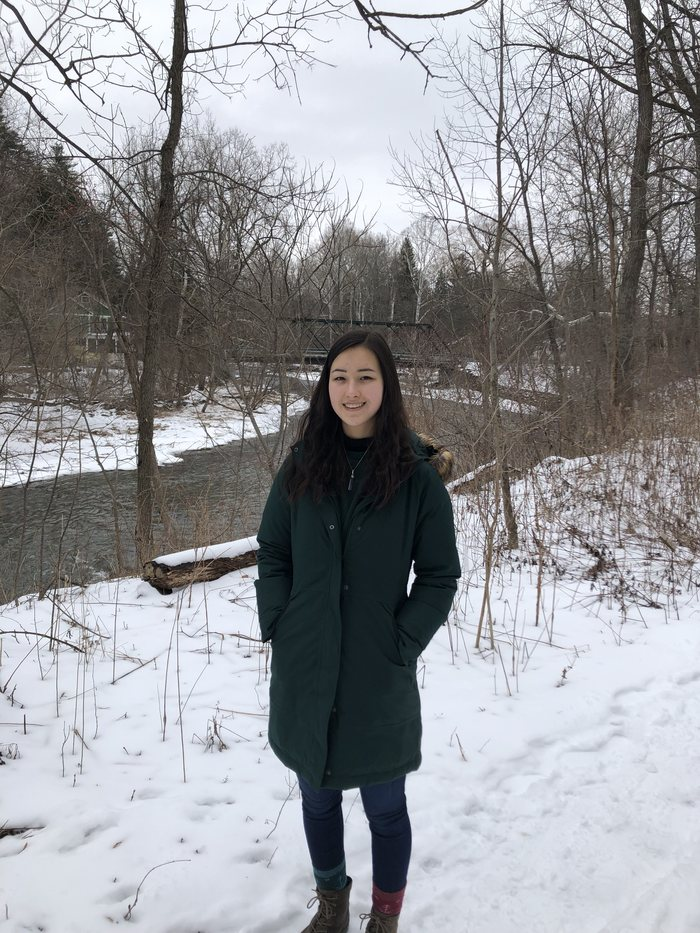</div>
<div class="person-details">
<h3 class="person-name">Nicole Hempel</h3>
<p class="person-role">Undergraduate Researcher</p>

</div>
</div>

<div class="person-card">
<div class="person-photo-wrapper">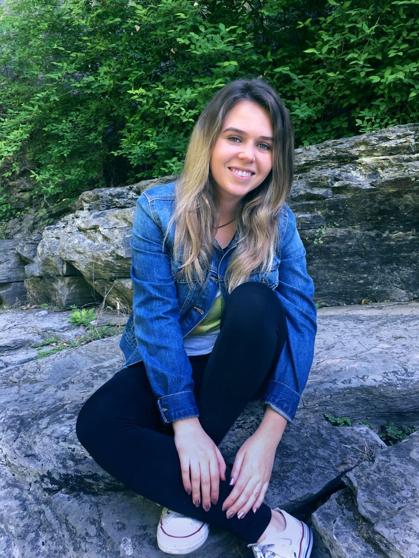</div>
<div class="person-details">
<h3 class="person-name">Allie Hermanson</h3>
<p class="person-role">Undergraduate Researcher</p>

</div>
</div>

<div class="person-card">
<div class="person-photo-wrapper">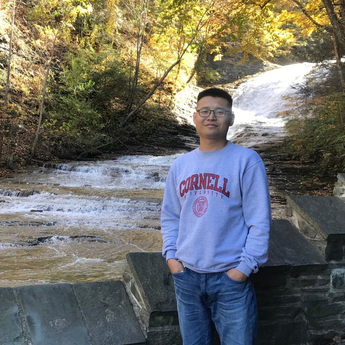</div>
<div class="person-details">
<h3 class="person-name">Yuanzheng Yue</h3>
<p class="person-role">Visiting Postdoctoral Scholar</p>

</div>
</div>

<div class="person-card">
<div class="person-photo-wrapper">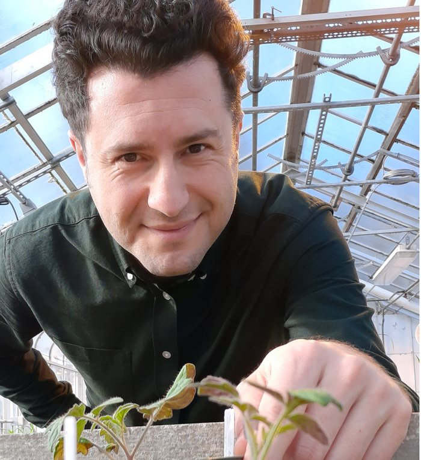</div>
<div class="person-details">
<h3 class="person-name">Dr. Hamid Razifard</h3>
<p class="person-role">Post-Doctoral Researcher</p>

</div>
</div>

<div class="person-card">
<div class="person-photo-wrapper">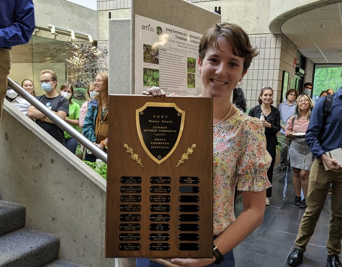</div>
<div class="person-details">
<h3 class="person-name">Eliza O&#x27;Donnell</h3>
<p class="person-role">REU Intern</p>

</div>
</div>

<div class="person-card">
<div class="person-photo-wrapper">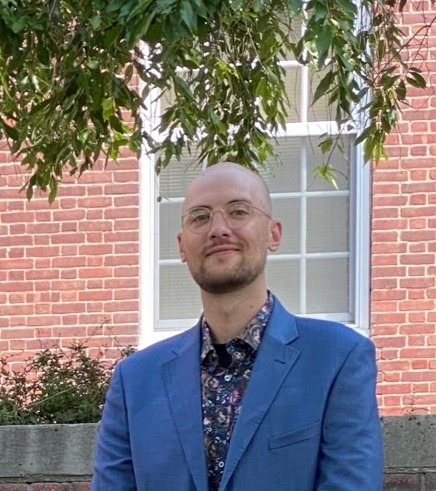</div>
<div class="person-details">
<h3 class="person-name">David Zimmerman</h3>
<p class="person-role">REU Intern</p>

</div>
</div>

<div class="person-card">
<div class="person-photo-wrapper">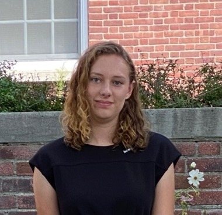</div>
<div class="person-details">
<h3 class="person-name">Kylie Shae Weis</h3>
<p class="person-role">REU Intern</p>

</div>
</div>

<div class="person-card">
<div class="person-photo-wrapper">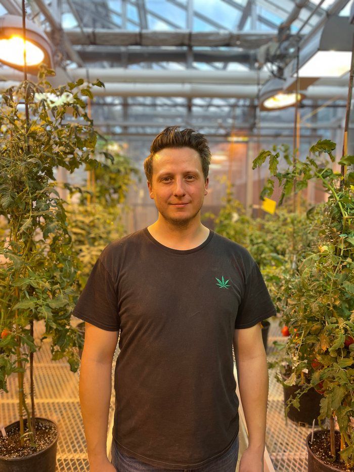</div>
<div class="person-details">
<h3 class="person-name">Kyle Griswold</h3>
<p class="person-role">Undergraduate Researcher</p>

</div>
</div>

<div class="person-card">
<div class="person-photo-wrapper">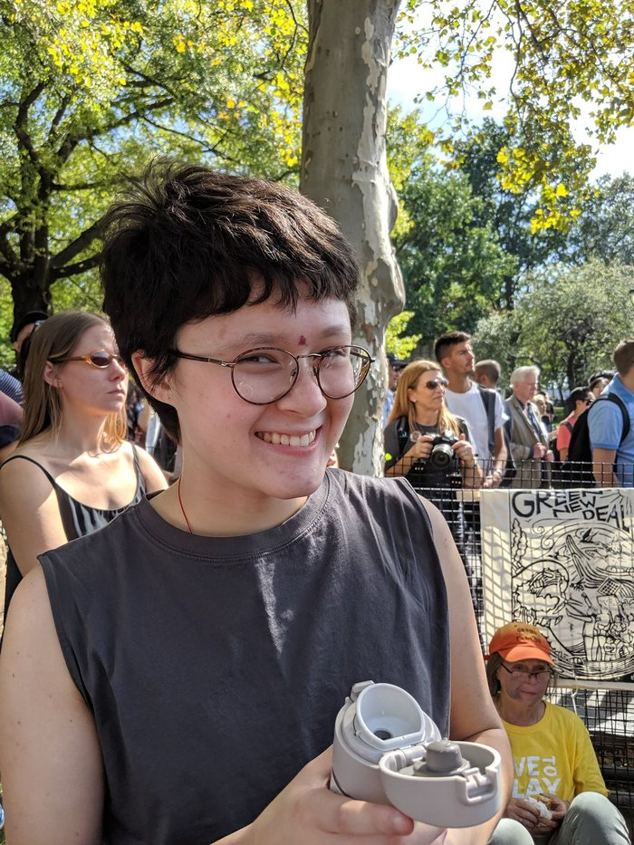</div>
<div class="person-details">
<h3 class="person-name">Jules Hart</h3>
<p class="person-role">Undergraduate Researcher</p>

</div>
</div>

<div class="person-card">
<div class="person-photo-wrapper">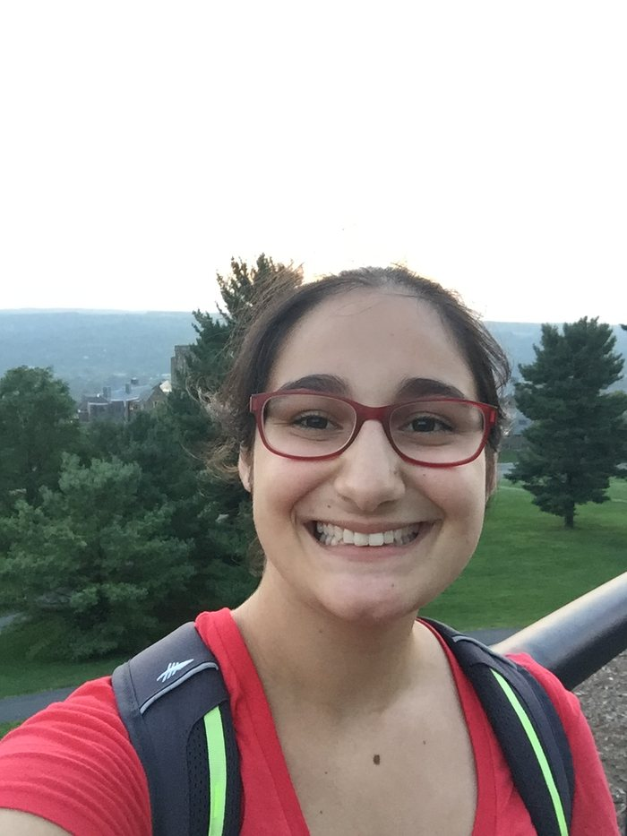</div>
<div class="person-details">
<h3 class="person-name">Alice Gevorgyan</h3>
<p class="person-role">Undergraduate Researcher &amp; Lab Technician</p>

</div>
</div>

<div class="person-card">
<div class="person-photo-wrapper"></div>
<div class="person-details">
<h3 class="person-name">Thomas Lonergan</h3>
<p class="person-role">Research Assistant</p>

</div>
</div>

<div class="person-card">
<div class="person-photo-wrapper"></div>
<div class="person-details">
<h3 class="person-name">Alexis Ellis</h3>
<p class="person-role">REU Intern</p>

</div>
</div>

<div class="person-card">
<div class="person-photo-wrapper"></div>
<div class="person-details">
<h3 class="person-name">Oge Okpala</h3>
<p class="person-role">REU Intern</p>

</div>
</div>

<div class="person-card">
<div class="person-photo-wrapper"></div>
<div class="person-details">
<h3 class="person-name">Arielle Johnson</h3>
<p class="person-role">Ph.D. Recipient</p>

</div>
</div>

<div class="person-card">
<div class="person-photo-wrapper"></div>
<div class="person-details">
<h3 class="person-name">Lara Jacobowitz</h3>
<p class="person-role">REU Intern</p>

</div>
</div>

<div class="person-card">
<div class="person-photo-wrapper"></div>
<div class="person-details">
<h3 class="person-name">Matthew Norman-Ariztía</h3>
<p class="person-role">Undergraduate Researcher</p>

</div>
</div>

<div class="person-card">
<div class="person-photo-wrapper"></div>
<div class="person-details">
<h3 class="person-name">Adrian Munoz</h3>
<p class="person-role">REU intern</p>

</div>
</div>

<div class="person-card">
<div class="person-photo-wrapper"></div>
<div class="person-details">
<h3 class="person-name">Felix Guo</h3>
<p class="person-role">REU intern</p>

</div>
</div>

<div class="person-card">
<div class="person-photo-wrapper"></div>
<div class="person-details">
<h3 class="person-name">Vesna Bacheva</h3>
<p class="person-role">Former Post-Doctoral Researcher

Assistant Professor

at the University of Groningen</p>

</div>
</div>

<div class="person-card">
<div class="person-photo-wrapper"></div>
<div class="person-details">
<h3 class="person-name">Juliane Scholtz</h3>
<p class="person-role">Laboratory and Research Technician</p>

</div>
</div>

<div class="person-card">
<div class="person-photo-wrapper"><div class="person-photo-placeholder">JG</div></div>
<div class="person-details">
<h3 class="person-name">Jack Greger</h3>
<p class="person-role">REU Intern</p>

</div>
</div>

<div class="person-card">
<div class="person-photo-wrapper"></div>
<div class="person-details">
<h3 class="person-name">Samantha Pelletier</h3>
<p class="person-role">Lab Technician</p>

</div>
</div>

<div class="person-card">
<div class="person-photo-wrapper"></div>
<div class="person-details">
<h3 class="person-name">Nicole Szeluga</h3>
<p class="person-role">Ph.D. Recipient</p>

</div>
</div>

<div class="person-card">
<div class="person-photo-wrapper"></div>
<div class="person-details">
<h3 class="person-name">Nat Michaels</h3>
<p class="person-role">REU Intern</p>

</div>
</div>

<div class="person-card">
<div class="person-photo-wrapper"></div>
<div class="person-details">
<h3 class="person-name">Etienne Exantus</h3>
<p class="person-role">BTI STEP Intern</p>

</div>
</div>

<div class="person-card">
<div class="person-photo-wrapper"></div>
<div class="person-details">
<h3 class="person-name">Allison Marie Kokal</h3>
<p class="person-role">REU Intern</p>

</div>
</div>

<div class="person-card">
<div class="person-photo-wrapper"></div>
<div class="person-details">
<h3 class="person-name">Diego Hernandez</h3>
<p class="person-role">Undergraduate Researcher</p>

</div>
</div>

<div class="person-card">
<div class="person-photo-wrapper"></div>
<div class="person-details">
<h3 class="person-name">Ophir Yaari</h3>
<p class="person-role">Visiting Undergraduate Researcher</p>

</div>
</div>

</div>

